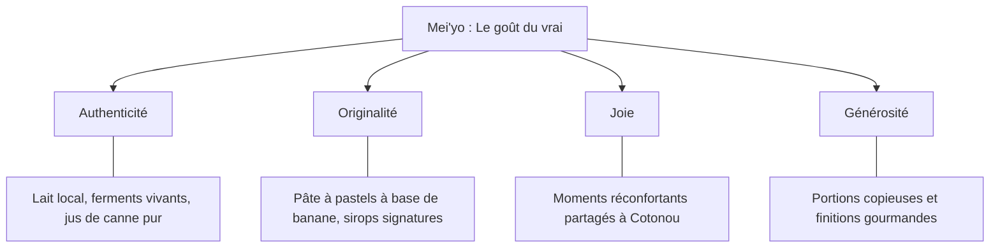
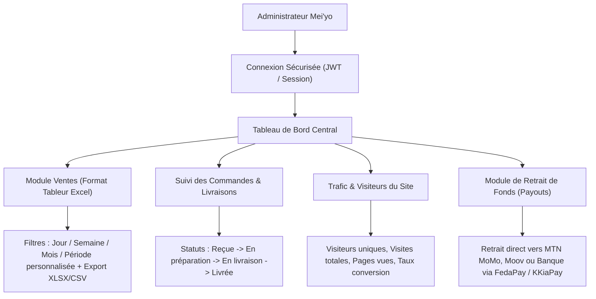
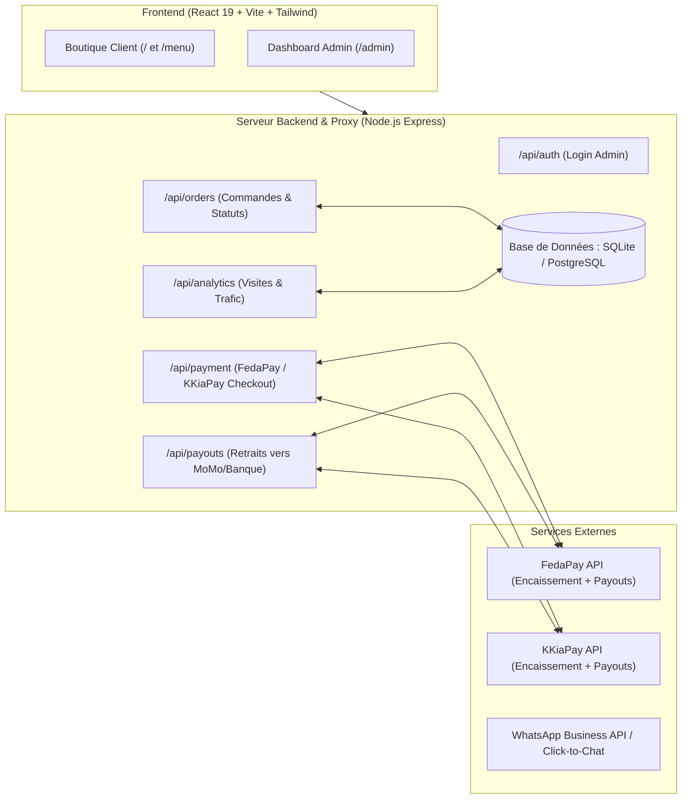
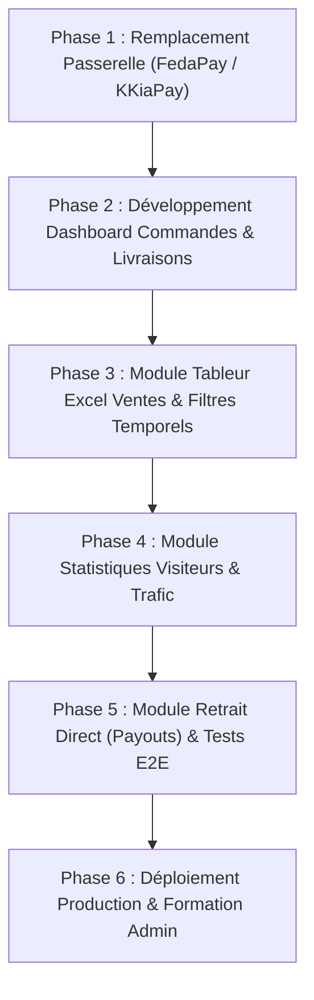

# Cahier des Charges — Plateforme Numérique & E-Commerce Mei'yo

---

## 1. Contexte & Présentation du Projet

### 1.1 Présentation de l'Entreprise
* **Nom de la marque** : Mei'yo
* **Slogan & Promesse** : *« Le goût du vrai »*
* **Date de création officielle** : Décembre 2025
* **Secteur d'activité** : Agroalimentaire artisanal, desserts lactés et pâtisseries fraîches.
* **Localisation** : Cotonou, République du Bénin.

### 1.2 Genèse et Philosophie
Née d'une passion artisanale initiée durant les années de lycée, Mei'yo s'est structurée fin 2025 en une maison gourmande béninoise dédiée aux préparations fraîches, saines et savoureuses. L'entreprise bannit les conservateurs industriels et le sucre raffiné, privilégiant les sirops naturels au pur jus de canne à sucre et la valorisation des matières premières locales (lait frais, pulpe de baobab sauvage, fleurs d'hibiscus/bissap, fruits tropicaux).

### 1.3 Les 4 Piliers Fondateurs

---

## 2. Objectifs Stratégiques & Cibles

### 2.1 Objectifs Business
1. **Canal de vente directe autonome** : Offrir aux clients de Cotonou un moyen instantané de commander leurs douceurs en ligne.
2. **Paiement digitalisé et localisé (Bénin & sous-région)** : Intégrer les passerelles de référence **FedaPay** et **KKiaPay** pour un encaissement direct par Mobile Money (MTN, Moov) et Carte Bancaire.
3. **Autonomie financière de l'administrateur** : Permettre au gérant de transférer ses fonds encaissés (retraits / payouts) directement vers son numéro Mobile Money ou compte bancaire depuis son tableau de bord.
4. **Pilotage des ventes et de la logistique** : Disposer d'un dashboard de gestion des commandes en temps réel, de suivi des livraisons, et d'un reporting des ventes au format tableur exploitable (type Excel) avec filtres journaliers, hebdomadaires et mensuels.
5. **Mesure de l'audience et optimisation continue** : Suivre le flux de visiteurs uniques pour adapter la carte et perfectionner le parcours utilisateur.

### 2.2 Publics Cibles & Personas
* **Persona 1 — Le Consommateur Urbain (25-38 ans)** : Actifs à Cotonou (Haie Vive, Ganhi, Cadjêhoun). Recherche des déjeuners et encas sains, livrés au bureau ou à domicile.
* **Persona 2 — La Famille / Mère soucieuse du bien-être** : Desserts sans sucre raffiné ni additifs chimiques pour les enfants et le foyer.
* **Persona 3 — L'Organisateur d'événements & Entreprises** : Commandes en gros volumes de pastels, crêpes et boissons traditionnelles pour cocktails et réunions.
* **Persona 4 — L'Administrateur / Gestionnaire Mei'yo** : Supervise la production, suit les livreurs, analyse le chiffre d'affaires et effectue les retraits de trésorerie en toute simplicité.

---

## 3. Périmètre Global du Projet (Scope)

```mermaid
graph LR
    subgraph FrontOffice["Front-Office Client"]
        F1["Catalogue dynamique & fiches produits"]
        F2["Panier interactif & persistance"]
        F3["Checkout & Options de livraison"]
        F4["Paiement sécurisé FedaPay / KKiaPay"]
        F5["Repli / Confirmation WhatsApp automatique"]
        F6["Suivi de commande & reçu numérique"]
    end

    subgraph BackOffice["Back-Office Administrateur"]
        B1["Authentification sécurisée Admin"]
        B2["Gestion des commandes & livraisons en cours"]
        B3["Tableau des ventes interactif format Excel"]
        B4["Filtres temporels : Jour / Semaine / Mois / Période"]
        B5["Statistiques d'audience & visites du site"]
        B6["Module de Retrait de fonds (Payouts FedaPay / KKiaPay)"]
    end

    FrontOffice <--> BackOffice
```

---

## 4. Spécifications Fonctionnelles — Espace Client (Front-Office)

### 4.1 Vitrine & Navigation
* **Page d'accueil (`HomePage`)** :
  * Bannière d'en-tête animée avec composant d'expansion visuelle (`HeroExpansion`).
  * Vitrine des catégories avec mécanique de cartes empilées (`StackedCardShuffle`).
  * Section narration de marque et valeurs fondamentales (`Story`).
  * Témoignages clients authentiques (`Testimonials`).
  * Barre de réassurance (fabrication du jour, paiement sécurisé, ingrédients naturels).
* **Page Histoire & Vision (`StoryPage`)** : Genèse de l'atelier, valeurs artisanales, mission et ancrage local.

### 4.2 Catalogue & Menu (`MenuPage`)
* **Catégories de douceurs** :
  1. *Les Yaourts* (Rubis Tropical bissap-pastèque, Brise d'Éden menthe-pomme, Soleil Épicé ananas-gingembre, Grec Velouté nature).
  2. *Les Pastels* (Pâte signature à la banane mûre : Bœuf fondant, Poulet braisé, Poisson côtier).
  3. *Les Crêpes* (Sucrées : choco-banane, fruits frais ; Salées : poulet-emmental, saucisse-fromage).
  4. *Les Flans* (Caramel ambré au lait de coco frais, Flan vanille Bourbon).
  5. *Boissons & Encas* (Baobab au lait frais / pain de singe, Pain au poulet doré).
* **Fiches Produits** : Ingrédients transparents, badges signature, prix en FCFA, sélecteur d'options et bouton d'ajout au panier.

### 4.3 Panier & Tunnel de Commande (`CheckoutPage`)
* **Tiroir Panier (`CartSidebar`)** : Modification directe des quantités, suppression, calcul dynamique du total.
* **Collecte des informations client** :
  * Prénom, Nom, Numéro de téléphone Mobile Money (MTN / Moov Bénin), Email.
  * Choix du mode d'obtention : Livraison à Cotonou (avec adresse et repères) ou Retrait à l'atelier.
  * Notes ou consignes de préparation.
* **Passerelles de Paiement Intégrées** :
  * **Option A : FedaPay Checkout** (MTN MoMo, Moov Money, Cartes Bancaires Visa/Mastercard).
  * **Option B : KKiaPay Widget / Redirect** (MTN MoMo, Moov Money, Celtiis Cash, Carte Bancaire).
  * **Option de Repli : Finalisation WhatsApp directe** avec panier pré-formaté vers le numéro officiel.

---

## 5. Spécifications Fonctionnelles — Espace Administrateur (Back-Office)

### 5.1 Authentification & Accès Sécurisé
* Page de connexion réservée (`/admin/login`).
* Authentification via identifiant / mot de passe chiffré (avec session chiffrée ou JWT sécurisé en cookie HttpOnly).
* Déconnexion automatique après inactivité prolongée.

### 5.2 Suivi des Commandes & Livraisons en Temps Réel
* **Vue opérationnelle des commandes** :
  * Liste actualisée en temps réel (ou rafraîchissement automatique paramétrable).
  * Fiche détaillée par commande : ID commande, nom & téléphone du client, articles commandés, montant total payé, adresse de livraison et consignes.
* **Pipeline de gestion des statuts de livraison** :
  * 🟡 *Reçue / Payée* (Commande confirmée, attente de confection).
  * 🟠 *En cours de préparation* (Cuisine / atelier en action).
  * 🔵 *En cours de livraison* (Assignée au coursier ou remise en cours).
  * 🟢 *Livrée / Terminée* (Remise au client effectuée).
  * 🔴 *Annulée / Remboursée*.
* Bouton d'action rapide pour contacter directement le client ou le livreur via WhatsApp ou appel téléphonique.

### 5.3 Tableau des Ventes Interactif (Format Tableur / Excel)
* **Interface visuelle type feuille de calcul** :
  * Colonnes : Date/Heure, Référence Commande, Client, Téléphone, Produits, Quantité totale, Montant (FCFA), Mode de paiement (FedaPay / KKiaPay), Statut.
  * Tri dynamique sur chaque colonne (croissant / décroissant).
* **Filtres temporels modulables à la demande** :
  * Par **Jour** (visualisation de la journée en cours ou d'une date spécifique sélectionnée sur calendrier).
  * Par **Semaine** (semaine en cours, semaine passée).
  * Par **Mois** (mensuel courant ou archivé).
  * **Période personnalisée** (sélecteur Date Début - Date Fin).
* **Indicateurs clés (KPIs) automatiques** :
  * Chiffre d'Affaires total sur la période sélectionnée.
  * Nombre total de commandes validées.
  * Panier moyen par client.
  * Top 3 des produits les plus vendus (ex : Yaourt Bissap-Pastèque, Pastels Bœuf).
* **Exportation** : Bouton d'export instantané en fichiers **Excel (.xlsx)** et **CSV** pour la comptabilité.

### 5.4 Statistiques d'Audience & Mesure de Trafic
* **Compteur de fréquentation** :
  * Nombre de visites totales et de visiteurs uniques journaliers / hebdomadaires / mensuels.
  * Graphique d'évolution des visites dans le temps.
* **Indicateurs d'optimisation de la boutique** :
  * Pages les plus consultées (Accueil, Menu, Histoire).
  * Taux de conversion visiteur -> ajout au panier -> commande payée.
  * Origine des appareils (Mobile vs Ordinateur) pour garantir une expérience optimale sur smartphone.

### 5.5 Module Financier & Retrait Direct (Payouts)
* **Visualisation des soldes** :
  * Solde disponible sur le compte marchand FedaPay / KKiaPay.
  * Total des encaissements de la semaine / du mois.
  * Frais de transaction déduits.
* **Déclenchement du retrait de fonds en direct (Payout)** :
  * Formulaire de retrait intégré au dashboard sans quitter l'application Mei'yo.
  * Saisie du montant à retirer en FCFA.
  * Choix de la destination du virement :
    * Compte **MTN Mobile Money Bénin** (numéro marchand / gérant).
    * Compte **Moov Money Bénin**.
    * Virement vers compte bancaire local (IBAN / RIB).
  * Appel sécurisé à l'API Payouts (FedaPay Payouts API ou KKiaPay Transfer API).
  * Historique complet des retraits effectués avec date, montant, référence de transaction et statut (Validé / En attente / Échoué).

---

## 6. Spécifications Techniques & Architecture

### 6.1 Schéma d'Architecture Système

### 6.2 Stack Technologique Actualisée
* **Frontend** :
  * React 19 + Vite 8.
  * Tailwind CSS v4 (Glassmorphisme soigné, fonds transparents, nuances émeraude et sable).
  * Bibliothèques UI : Lucide React (aucune émoticône), Radix UI / Shadcn UI primitives.
  * Animations : GSAP (ScrollTrigger) & Framer Motion.
  * Tableur & Graphiques Admin : Composants de table de données avec tri/filtres + Chart.js / Recharts pour les graphiques de visites.
  * Librairie d'export tableur : `xlsx` ou `exceljs` pour la génération des fichiers Excel côté client ou serveur.
* **Backend & API** :
  * Node.js & Express 5.
  * Base de données : SQLite pour le développement local / PostgreSQL (Supabase ou Neon) pour la production.
  * ORM / Requêteur : Prisma ou Drizzle ORM pour un typage et des requêtes optimisées.
  * Module d'analyse de trafic anonymisé (enregistrement léger des sessions sans cookies intrusifs, respectueux de la vie privée).
* **Passerelles de Paiement & Payouts** :
  * SDK officiel `@fedapay/fedapay-node` pour l'encaissement et l'API des transferts/retraits.
  * API / SDK KKiaPay pour la redondance et les paiements directs.

### 6.3 Tokens Visuels & Charte Graphique
| Token | Code Couleur | Utilisation |
| :--- | :--- | :--- |
| **Vert Émeraude Profond** | `#254631` | Identité Mei'yo, en-têtes, boutons d'action clés |
| **Vert Sauge Végétal** | `#366848` / `#A7C0A1` | Bordures douces, badges d'état, accents secondaires |
| **Doré Solaire** | `#F0D28E` / `#F6E2B8` | Badges "Signature", alertes douces, rehauts graphiques |
| **Crème / Sable Chaud** | `#FFFBF3` / `#FFF8E3` | Arrière-plans, cartes glassmorphiques |
| **Ardoise Sombre** | `#1F241E` / `#4A5568` | Textes principaux, tableaux de données pour un contraste parfait |

---

## 7. Sécurité, Rôles & Intégrité Financière

1. **Cloisonnement Absolu des Retraits (Payouts)** :
   * L'accès au module de retrait nécessite une double confirmation (code PIN administrateur ou mot de passe réclamé à chaque demande de retrait).
   * Les requêtes de virement s'exécutent exclusivement côté serveur via clé secrète FedaPay/KKiaPay (jamais exposée au navigateur).
2. **Webhooks Sécurisés avec Signature Cryptographique** :
   * Traitement des notifications de paiement réussies via les webhooks FedaPay/KKiaPay avec contrôle obligatoire du hash / signature secrète.
3. **Journal d'Audit Financier** :
   * Tout retrait initié ou changement de statut de commande est consigné dans un journal d'activité inaltérable (date, IP, utilisateur, montant).
4. **Protection des Données Clients** :
   * Données de commande hébergées de manière sécurisée et chiffrée, conformité APDP Bénin.

---

## 8. Calendrier de Déploiement & Phases

* **Phase 1** : Remplacement du module Maketou par l'intégration du SDK FedaPay / KKiaPay (encaissement MTN / Moov).
* **Phase 2** : Mise en place de l'espace admin, de la base de données des commandes et du tableau de suivi des livraisons en cours.
* **Phase 3** : Conception de l'interface tableur type Excel avec filtres par jour, semaine, mois, et moteur d'export XLSX.
* **Phase 4** : Implémentation du tracker léger de visiteurs uniques et affichage des graphiques d'audience.
* **Phase 5** : Implémentation de la fonction de retrait direct vers Mobile Money depuis le dashboard avec validation de sécurité.
* **Phase 6** : Tests réels (prélèvement et retrait test de 500 FCFA), validation finale et livraison des accès administrateur.
